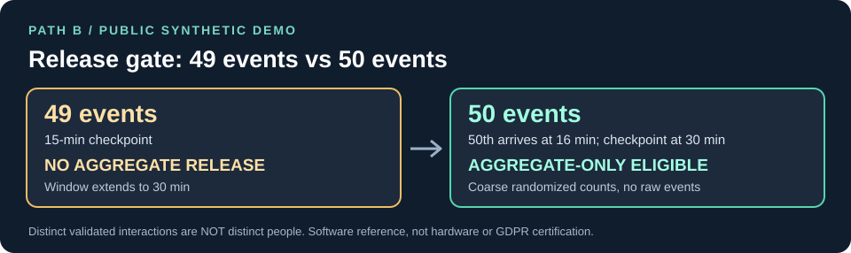

# ATDA | Privacy-First Distributed Chemical Sensing

**How can critical infrastructure detect potentially hazardous chemical traces without building a database of people?**

ATDA (*Anonymous Trace-Detection Analytics*) is a **public research architecture** by V. Panov for separating high-consequence safety alerts from background chemical-trace statistics. It proposes physically independent payment and sensor trust domains, constrained data schemas, an adaptive local **k >= 50 interaction-event** release gate, and a long-term post-quantum security migration plan.

[](https://github.com/slavonslavon50-web/ATDA-WhitePaper/actions/workflows/ci.yml)
[**Open the live interactive demo**](https://slavonslavon50-web.github.io/ATDA-WhitePaper/) · [Read the specification](specs/ATDA_Technical_Spec_v1_2.md) · [Inspect the privacy analysis](docs/PRIVACY_PROOF.md) · [Review hardware proposal](hardware/HW01_ARCHITECTURE.md) · [Contribute technical feedback](CONTRIBUTING.md)

> **Maturity:** a reconstructed, unit-tested **synthetic-data research reference**, **not a deployed chemical detector**. No hardware PII isolation, sensor performance, end-to-end anonymisation, FIPS validation or industrial certification is claimed.

## A 30-second demonstration: 49 -> 50



The working Python reference does **not** transmit when 49 valid, distinct **interaction events** have accumulated at the 15-minute checkpoint. If the 50th event arrives at minute 16, the aggregate is not emitted immediately: only **at the next checkpoint, minute 30**, can a randomized, coarse aggregate be released.

**Run the real reference kernel locally (Python 3.10+, standard library only):**

```bash
python3 demo/demo_49_to_50.py
```

```text
00:15  CHECKPOINT: 49 < 50 -> NO AGGREGATE RELEASE; window extends to 30 min
00:16  50th synthetic interaction accepted -> still NO RELEASE before checkpoint
00:30  CHECKPOINT: 50 >= 50 -> AGGREGATE RELEASE ELIGIBLE (30-min window)
Export schema: zone, window_start_utc_min, window_minutes, noisy_counts, policy_version
```

The demo invokes [`FortressBuffer`](src/atda_pathb_fortress.py), not an unrelated mock implementation. Randomized numerical outputs vary; the release decision is deterministic. The [interactive walkthrough is now published on GitHub Pages](https://slavonslavon50-web.github.io/ATDA-WhitePaper/); its [HTML source](docs/index.html) can also be inspected or opened offline. Read the [demo walkthrough](demo/README.md) for exact limits and reproducible steps.

**Critical distinction:** the threshold counts *interactions, not unique individuals*. The publication/no-publication boundary itself leaks threshold information and is **not end-to-end pure epsilon-differential privacy**. See [the mathematical assessment](docs/PRIVACY_PROOF.md). In a real system, hardware removal of payment PII must be demonstrated *before buffering*; these software tests do not verify it.

## Architecture: two paths, different purposes

| | Path A — urgent safety | Path B — background statistics |
|---|---|---|
| **Allowed purpose** | Independently verified, high-confidence explosives/CBRN alerts | Coarse narcotics and non-immediate hazard trends |
| **Data** | Restricted authenticated threat event; no payment PII | Only local category counts and coarse randomized aggregates |
| **Decision** | Safety governance and independent validation | No statistical output under k=50; adaptive 15 min to 24 h windows |
| **Prohibited** | Cleaner-only nuisance alarms as security incidents | Personal tracking, per-event export, identity joins or individual enforcement |

Cleaning interferents are designed to trigger maintenance handling, **not a security alert on their own**. Physical sensor effectiveness, independence of Path A and the proposed one-way Path B egress remain to be measured in a laboratory.

## What is available now

| Artifact | Status | Start here |
|---|---|---|
| Python Path B aggregation reference | Unit tested with synthetic data | [`src/atda_pathb_fortress.py`](src/atda_pathb_fortress.py) |
| Public threshold demonstration | Executable with real reference kernel | [`demo/demo_49_to_50.py`](demo/demo_49_to_50.py) |
| Hardware PII-isolation design | **Unbuilt** proposal | [`hardware/HW01_ARCHITECTURE.md`](hardware/HW01_ARCHITECTURE.md) |
| Hardware acceptance criteria | 16 proposed bench tests; not yet performed | [`hardware/HW01_VERIFICATION_MATRIX.md`](hardware/HW01_VERIFICATION_MATRIX.md) |
| Threat and privacy analysis | Research assessment; independent review requested | [`docs/THREAT_MODEL.md`](docs/THREAT_MODEL.md) and [`docs/PRIVACY_PROOF.md`](docs/PRIVACY_PROOF.md) |
| PQC transition plan | Design only, not implemented cryptographic module | [`docs/PQC_MIGRATION.md`](docs/PQC_MIGRATION.md) |
| Full technical specification | Proposed engineering requirements | [`specs/ATDA_Technical_Spec_v1_2.md`](specs/ATDA_Technical_Spec_v1_2.md) |

Further reading: [machine-readable manifest](manifest/ATDA_Privacy_Safety_Manifest_v1_2.json) · [TCO and engineering roadmap](docs/TCO_AND_ROADMAP.md).

## Reproduce the checks

```bash
python3 -m unittest discover -s tests -v
python3 manifest/validate_manifest.py
```

The same tests run in [GitHub Actions](https://github.com/slavonslavon50-web/ATDA-WhitePaper/actions/workflows/ci.yml). Passing software tests **does not** prove PII isolation, legality, cryptographic certification, or physical detectability of chemicals.

## Who should review ATDA?

ATDA is seeking **independent technical criticism**, not endorsements or promotional partnerships. These are suggested audiences, **not organisations affiliated with or reviewing the project**.

| Audience | Relevant expertise | A useful first review |
|---|---|---|
| **Universities and research groups** — e.g. researchers at Trinity College Dublin or University College Dublin | Privacy engineering, formal methods, embedded security, differential privacy | Challenge the hard k=50 privacy limits, side-channel assumptions and hardware trust boundaries |
| **Chemical-sensor and embedded-hardware manufacturers** | Sensor electronics, secure MCUs, isolation, tamper-resistance and environmental interference | Assess whether the proposed [HW-01 isolated sensor node](hardware/HW01_ARCHITECTURE.md) can be built, electrically verified and tested with synthetic signals |
| **Critical-infrastructure security and standards specialists** — including those familiar with NIST, ENISA and IEC 62443 | Threat modelling, procurement assurance, regulations, zero trust and cryptographic migration | Check control mappings and the [PQC roadmap](docs/PQC_MIGRATION.md) against real procurement and operational constraints |

**How to help:** [Open a technical feedback issue](https://github.com/slavonslavon50-web/ATDA-WhitePaper/issues/new) citing a specific assumption, a failing test or a proposed measurable acceptance criterion. See [CONTRIBUTING.md](CONTRIBUTING.md) first. Do not include any real payment, personal or sensitive operational data.

## Research questions worth challenging

1. Can a physical sensor-only boundary be independently verified to prevent every payment/access identity ingress, including maintenance and covert channels?
2. How can a hard k=50 gate, useful local statistics and strong formal privacy guarantees be reconciled when the release event itself reveals information?
3. Can cleaning-agent interference be handled without concealing an independently verified high-consequence threat?
4. Which sensor and attestation hardware can be updated and supported through 2040, including the post-quantum transition?

**We welcome critical engineering feedback, reproducible test cases, privacy counterexamples, and independent review.** Please open a [GitHub issue](https://github.com/slavonslavon50-web/ATDA-WhitePaper/issues) after reading [CONTRIBUTING.md](CONTRIBUTING.md). Do not submit real payment or personal data, operational threat signatures or exploitable infrastructure deployment details.

## Provenance, standards and re-use

- **Original architecture:** V. Panov, white paper dated **5 December 2025**. GitHub created 5 December 2025; the historical single-file commit is dated 30 January 2026.
- **Current reference:** reconstructed software and security documents dated **27 October 2026**. The original commit remains intact. See [provenance](docs/PROVENANCE.md) and [citation metadata](CITATION.cff).
- The design discusses NIST SP 800-53, FIPS 203/204/205, GDPR Articles 5/25/35, ISO/IEC 27001 and IEC 62443 as *references*, **not certifications or endorsements**.
- The original white paper described an open defensive disclosure. **No code licence has yet been selected**: public accessibility alone does not grant an unrestricted right to reuse code. [Security reporting policy](SECURITY.md).

**ATDA seeks a measurable privacy boundary, not a claim that surveillance becomes harmless when its data are aggregated.**
